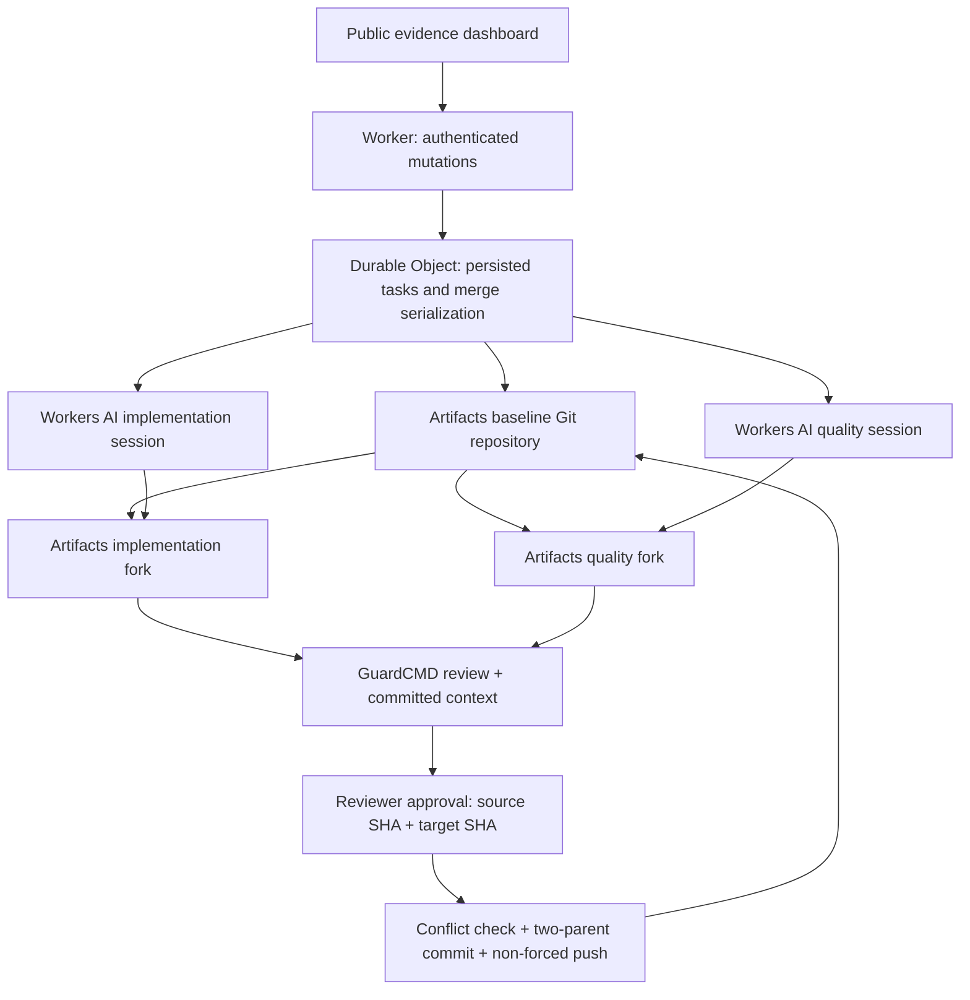

# Cloudflare architecture

## Runtime boundaries

The Worker checks operator/reviewer bearer credentials before forwarding mutations. The Durable Object is not publicly addressable and stores the task index and all evidence. Its mutation queue serializes approvals and merges. A single queued task runs two `AI.run` calls concurrently inside a background alarm. No model receives either application credential or an Artifacts write token.

Each task starts with the original Harbor Tasks utility or the intentionally flawed public signup fixture. `ARTIFACTS.create` creates its remote; `isomorphic-git` writes and pushes the initial commit. `repo.fork` creates two real repositories. Short-lived repository tokens support Git reads/writes inside the coordinator; they are not persisted in task state or returned by the dashboard API.

`memfs` holds only a bounded working tree in memory. Proposals contain complete text files from an allowlist. Validation rejects traversal, Git metadata, environment files, package manifests, duplicate paths and oversized output. Generated code is never evaluated by the Worker.

## Review and integration

The published GuardCMD engine scores a custom code signal in shadow mode. Rules identify examples of shell operations, credential literals, dynamic evaluation, sensitive runtime access and external destinations. These heuristics can miss vulnerabilities and produce false positives; the dashboard never equates an `allow` verdict with proven-safe code.

A reviewer approval includes both proposal and current target SHA. The merge path clones the current target, fetches the proposal objects, verifies both SHAs, compares the proposed files with reviewed content and performs a conservative three-way file conflict check. A two-parent commit retains the target and proposal ancestry, along with agent context. A non-forced push protects against remote races. Successful integration invalidates all prior target approvals.

## Isolation and operational scope

- Worker: `guardcmd-agentguard`; competition-only custom domain `demo.guardcmd.ai`, explicitly requested by the owner.
- Artifacts namespace: `agentguard-competition`.
- No Railway deployment changes; existing main-site and API DNS records remain untouched. Only the new competition hostname was added.
- No modification to other Workers or Cloudflare projects.
- Artifacts and Workers AI are actual remote services, not in-browser simulations.
- At most 20 sample tasks, two model calls per normal task, 3,000 output tokens each, and at most one validation-repair call per agent. Only credentialed operators can spend inference budget.
- The public demo is single-workspace and intentionally exposes sample evidence. It is not a general-purpose private repository host.

## Primary references

- [Artifacts binding](https://developers.cloudflare.com/artifacts/api/workers-binding/)
- [Git from Workers](https://developers.cloudflare.com/artifacts/examples/isomorphic-git/)
- [Artifacts REST API](https://developers.cloudflare.com/artifacts/api/rest-api/)
- [Qwen coding model](https://developers.cloudflare.com/workers-ai/models/qwen2.5-coder-32b-instruct/)
- [Published GuardCMD MCP interfaces](https://github.com/guardcmd/guardcmd)
